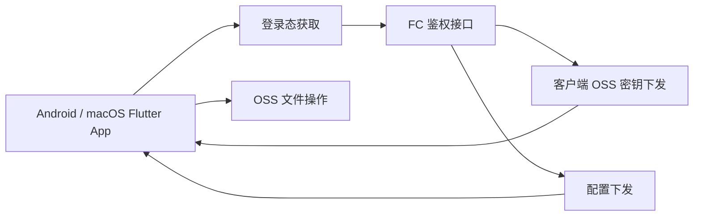
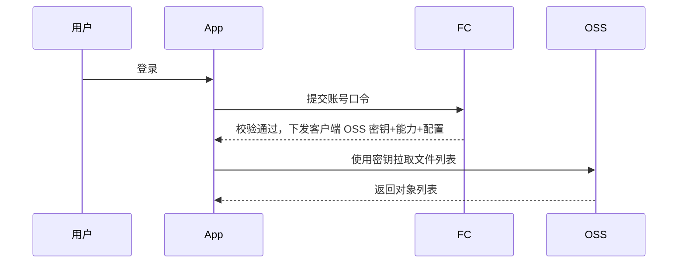

# 私域网盘技术文档

## 1. 文档概述

- 关联产品文档：
  - [PRD.md](./PRD.md)
  - [Flutter架构设计.md](./Flutter架构设计.md)


- 项目名称：私域网盘
- 文档类型：一期技术方案文档
- 依据文档：[PRD.md](/Users/littlefisher/Documents/LittleFisher/Workspaces/jyn/private-domain-drive/docs/PRD.md)
- 目标平台：Android、macOS
- 技术目标：在不引入传统重后端、数据库和复杂权限后台的前提下，落地一套基于阿里云 OSS 的轻量共享文件方案。

## 2. 设计目标

### 2.1 目标

- 支持 Android 与 macOS 共用同一套核心业务逻辑
- 通过轻量云端能力完成身份校验与客户端访问密钥下发
- 支持文件浏览、上传、下载、删除和基础预览
- 权限以阿里云侧鉴权为准，客户端只负责能力呈现
- 控制固定成本与运维复杂度

### 2.2 非目标

- 不建设自有用户中心、数据库后台、审计中心
- 不做公开注册链接、在线协同编辑、复杂搜索
- 不做视频在线播放转码、Office 在线编辑
- 不做大规模用户、多租户能力

## 3. 总体架构

### 3.1 架构选型

- 客户端：Flutter
- 文件存储：阿里云 OSS
- 访问凭证：双 AccessKey 直连（登录时由 FC 下发受限客户端密钥）
- 轻后端：阿里云函数计算 FC
- 可选入口：阿里云 API 网关
- 轻量配置：函数环境变量或 OSS 中的 JSON 配置文件

### 3.2 架构原则

- 文件数据直接存储在 OSS，不经业务后端中转
- 业务后端只处理鉴权、凭证签发和少量配置下发
- 权限控制放在云侧，避免仅靠客户端 UI 限制
- 客户端尽量复用逻辑，平台差异集中在文件选择、存储、预览和拖拽能力

### 3.3 逻辑架构图



## 4. 模块划分

### 4.1 客户端模块

#### 4.1.1 认证模块

- 管理登录态
- 登录时从轻后端获取受限客户端 OSS 密钥
- 处理密钥失效与重新登录

#### 4.1.2 文件浏览模块

- 按目录前缀列出文件与文件夹
- 展示文件名、大小、更新时间、类型
- 支持刷新、空态、错误态

#### 4.1.3 上传模块

- Android 调用系统文件选择器
- macOS 支持文件选择与拖拽上传
- 支持上传进度、失败重试、分片上传

#### 4.1.4 下载模块

- 发起下载任务
- 保存到本地目录
- 展示进度、状态与失败重试

#### 4.1.5 预览模块

- 图片预览
- PDF 预览
- 文本预览

#### 4.1.6 权限展示模块

- 根据服务端返回的能力信息控制按钮显隐
- 对关键操作做前置能力判断
- 最终结果仍以 OSS 鉴权结果为准

#### 4.1.7 任务与错误处理模块

- 统一管理上传下载任务状态
- 处理网络异常、凭证失效、权限不足等错误
- 给出明确提示与重试入口

### 4.2 云端模块

#### 4.2.1 鉴权与凭证签发函数

职责：

- 校验当前登录用户身份
- 返回受限客户端 OSS 访问密钥与基础配置
- 返回基础能力描述与必要配置

#### 4.2.2 配置管理

职责：

- 管理 bucket、endpoint、根目录前缀
- 管理角色到能力的映射
- 管理客户端需要的预览白名单、上传限制等基础配置

#### 4.2.3 OSS 存储层

职责：

- 存储共享文件数据
- 基于 RAM 权限策略执行真实访问控制
- 提供列举、上传、下载、删除能力

## 5. 目录与数据组织

### 5.1 OSS 目录建议

```text
shared/
  common/
  photos/
  docs/
  uploads/
```

如后续需要扩展个人空间，可增加：

```text
users/
  user-a/
  user-b/
```

内部约定目录（点前缀，文件浏览、目录统计与相册索引统一隐藏）：

```text
shared/
  .trash/     回收站条目（逐项独立 manifest）与恢复信息
  .gallery/   相册索引与视频缩略图
  .moves/     文件夹移动 manifest
  .aliases/   目录别名表 links.json
```

其中 `.aliases/links.json` 为目录别名（虚拟目录链接）表：`version` + `links[]`（`id`/`name`/`targetPrefix`/`parent`/`createdBy`/`createdAt`）。别名由客户端应用层实现（OSS 软链接不支持目录语义），可挂载到 `shared/` 下任意真实目录层级（`parent` 缺失按根目录解析，兼容存量表），写入采用读-改-写 + 写前复查 ETag 的乐观并发；别名仅是指向 `targetPrefix` 的入口，删除链接不影响目标目录及其内容。

### 5.2 对象元数据策略

一期不单独建设业务数据库，对象信息以 OSS 为主：

- 文件名：来自对象 key
- 文件大小：来自 OSS 元数据
- 更新时间：来自 OSS 返回字段
- 文件类型：基于扩展名和 MIME 推断

### 5.3 配置存储建议

优先级如下：

1. FC 环境变量：适合少量固定配置
2. OSS JSON 配置：适合需要集中维护的角色与能力配置

当前用户目录采用 OSS JSON 配置，固定对象键为 `config/users.json`，位于网盘展示目录之外。

用户条目至少包含 `account`、`password`（Node.js scrypt 编码哈希）和 `userId`，可选 `displayName`、`mustResetPassword`。一期不依赖用户角色；`mustResetPassword` 缺失按 `false` 处理。服务端 RAM 身份（pdd-server）仅允许读写该对象，客户端密钥对应的 RAM 身份（pdd-client）仍只授予 `shared/` 前缀，不能访问用户目录。

建议配置项：

- `bucket`
- `endpoint`
- `root_prefix`
- `role_capabilities`
- `preview_extensions`
- `upload_constraints`

## 6. 权限模型设计

### 6.1 兼容性说明

旧客户端可能保留 `role` 字段，但服务端不再依据角色判断能力或改密权限。

### 6.2 能力定义

- `list`
- `download`
- `upload`
- `delete`
- `preview`

### 6.3 设计原则

- 客户端不内置长期高权限密钥
- 客户端不以本地角色判断作为唯一安全依据
- 下发到客户端的密钥通过受限 RAM 身份限制到指定 bucket 和 prefix
- 删除等高风险操作需同时满足 UI 能力开放和云端真实授权

### 6.4 建议返回的能力结构

```json
{
  "userId": "user-a",
  "role": "member",
  "rootPrefix": "shared/",
  "capabilities": {
    "list": true,
    "download": true,
    "upload": true,
    "delete": true,
    "preview": true
  }
}
```

## 7. 接口设计

### 7.1 会话初始化接口

#### 接口职责

- 校验账号口令并返回受限客户端 OSS 访问密钥
- 返回当前用户、根目录范围与能力描述

#### 请求示例

```json
{
  "account": "user-a",
  "password": "xxx",
  "platform": "macos",
  "appVersion": "1.0.0"
}
```

#### 响应示例

```json
{
  "clientCredentials": {
    "accessKeyId": "LTAI.xxx",
    "accessKeySecret": "xxx"
  },
  "oss": {
    "bucket": "private-domain-drive",
    "endpoint": "oss-cn-hangzhou.aliyuncs.com",
    "region": "cn-hangzhou",
    "rootPrefix": "shared/"
  },
  "user": {
    "userId": "user-a"
  },
  "capabilities": {
    "list": true,
    "download": true,
    "upload": true,
    "delete": true,
    "preview": true
  }
}
```

接口字段与错误码的完整契约见 [接口文档](./接口.md)。

### 7.2 客户端与 OSS 的交互方式

- Flutter 业务层只通过本地 `private_domain_oss` 插件访问 OSS，不实现 REST 签名、XML 解析或 HTTP fallback。
- Android 固定使用阿里云 OSS Android SDK `2.9.21`；macOS 固定使用 OSS SDK for Swift V2 `0.3.0`。
- 登录下发的 AccessKey、Endpoint、Region 与 Bucket 在登录成功时原子更新到原生适配器，退出登录时清除。
- 下发的 AccessKey 对应受限 RAM 身份（pdd-client），策略限定在会话根目录内授予 `oss:ProcessObject`，使图片缩略图和图片预览可使用 OSS 图片处理；其他对象操作仍遵循最小权限范围。
- 列表、分页、目录占位、上传、下载、预览、缩略图、删除、批删和复制均由当前平台官方 SDK执行。
- 文件上传只跨平台传递本地路径；文件下载由 SDK直接写入临时路径。macOS 为使用官方文件下载 API，最低系统版本为 12.0。

### 7.3 是否引入 API 网关

建议：

- 若仅有少量鉴权接口，可先使用 FC HTTP 触发器
- 若后续需要统一域名、鉴权策略、限流和日志，可再接入 API 网关

## 8. 核心流程设计

### 8.1 登录与进入文件空间



### 8.2 上传流程

1. 用户选择文件或拖拽文件进入窗口。
2. 客户端校验当前目录、文件大小和上传能力。
3. 小文件走普通上传，大文件走分片上传。
4. 上传过程中展示进度、速度和结果状态。
5. 上传成功后刷新当前目录。
6. 上传失败时保留失败态并允许重试。
7. 任务在 OSS 返回最终成功后即标记完成；媒体文件的相册索引增量在后台更新（本地副本即时写入，清单经合并写队列收敛为少量读-改-写），不延迟任务状态、不占用传输并发槽。

### 8.3 下载流程

1. 用户点击下载。
2. 客户端校验下载能力并创建本地任务。
3. 使用登录下发的密钥从 OSS 下载对象。
4. 下载完成后写入本地目录并提示结果。

### 8.4 删除流程

1. 用户点击删除。
2. 客户端弹出二次确认。
3. 客户端先复制对象至 `shared/.trash/` 回收批次并写入恢复信息，再删除原对象。
4. OSS 根据客户端密钥真实鉴权；Bucket 生命周期规则在回收对象最后修改时间满 30 天后自动清理。
5. 成功则刷新列表，失败时原对象保留并提示原因；恢复不得覆盖已有对象。

## 9. 客户端实现建议

### 9.1 代码分层

建议采用以下分层：

- `presentation`：页面、组件、状态展示
- `application`：用例编排，如登录、列文件、上传、下载
- `domain`：文件实体、能力模型、任务状态模型
- `infrastructure`：OSS SDK、FC API、平台文件系统适配

该分层重点是隔离平台能力与业务逻辑，便于 Android、macOS 共用主体代码。

更完整的模块边界、目录结构、状态划分与落地顺序，见 [Flutter架构设计.md](./Flutter架构设计.md)。

### 9.2 状态管理建议

可选择 Flutter 常见轻量方案实现，例如：

- `Riverpod`
- `Bloc`
- 项目已存在方案

原则：

- 不为一期引入过重架构
- 凭证状态、当前目录、任务列表、错误提示需要可观察

### 9.3 平台差异点

Android：

- 使用系统文件选择器
- 适配移动端单栏结构
- 传输期间经 `dataSync` 前台服务保活（见 10.4），关注前后台切换后的任务状态恢复

macOS：

- 支持拖拽上传
- 可使用双栏或三栏布局
- 下载保存位置与本地文件访问体验需更贴近桌面习惯

## 10. 上传下载设计

### 10.1 上传策略

- 小文件：直接上传
- 大文件：分片上传
- 上传中断：允许重试
- 同名文件：一期建议先采用覆盖前确认策略
- 上传任务保存源文件路径、对象键和大小，重试复用原路径
- 进度以官方 SDK累计传输字节为准，速度使用最近 2 秒时间窗口平滑计算
- 字节发送完毕但 SDK尚未返回成功时展示“正在确认”

### 10.2 下载策略

- 下载到默认目录或用户选择目录
- 允许重复下载
- 下载完成后提供打开文件或打开目录入口
- 批量下载选择一次目标目录，每个文件独立流式写入本地临时文件后完成落盘，不生成 ZIP
- 上传、下载使用同一内存任务队列；总并发数可配置为 1 至 5，默认 3
- 批量删除先递归分页列举目录对象，再按 OSS 多对象删除上限分批执行；允许部分失败并返回失败项
- 取消运行中任务必须中止原生 SDK请求，不能只改变 UI 状态
- 上传与下载任务共用同一套时间线、统计字段与传输历史；已结束卡片展示文件大小、结束时间、耗时与平均速度，任务详情展示完整时间线与尝试次数（详见 10.3）

### 10.3 任务状态模型

建议统一抽象以下状态：

- `pending`
- `running`
- `success`
- `failed`
- `canceled`

上传进程被中断后恢复出的任务另使用 `interrupted`，等待用户继续或放弃。

任务同时记录生命周期时间线与性能统计字段，上传与下载共用：

| 字段 | 语义 |
|---|---|
| `queuedAt` | 首次入队时间，重试不覆盖 |
| `startedAt` | 首次开始传输时间 |
| `lastStartedAt` | 最近一次开始传输时间 |
| `finishedAt` | 最近一次终态时间，重试重新入队时清空 |
| `activeDurationMs` | 跨尝试累计的实际传输时长（毫秒） |
| `totalTransferredBytes` | 跨尝试累计的实际传输字节 |
| `attemptCount` | 尝试次数，首次入队为 1，用户重试 +1 |

计时口径：

- 时间戳使用墙钟，统一以 UTC epoch 毫秒序列化，展示时转本地时区；旧记录缺失时展示占位符，`queuedAt` 缺失时可用任务 `id` 内嵌的微秒时间戳兜底。
- 耗时使用 `Stopwatch` 单调时钟统计，在队列每次运行收尾（成功、失败、取消、暂停继续）统一累加，不依赖时间戳差值，避免系统时钟调整导致负耗时。
- 暂停继续视为新的一次运行，累计时长与字节继续增加，但 `attemptCount` 不增加；只有用户主动重试才 +1。
- 平均速度为派生值：`totalTransferredBytes / (activeDurationMs / 1000)`，时长为零或累计字节未知时展示占位符，不落库。
- 平均速度按实际吞吐口径计算：重试从零重新下载时，累计字节包含重复下载量。

历史存储与保留：

- 终态任务（成功、失败、取消）写入独立的 SQLite 数据库 `transfer_history.db`，表 `transfer_history` 以任务 `id` 为主键，字段与任务模型对齐，并建立 `finished_at DESC` 与 `(type, finished_at DESC)` 索引。
- 终态变化以按行 upsert 增量写入，约 300ms 合并为单事务批量提交；清除已结束任务与重试时按 `id` 删除，不再全量重写历史。
- 启动时异步加载第一页 300 条，滚动到底部继续按 `finished_at DESC, id DESC` 游标分页；类型筛选计数由数据库分组计数与内存中未结束任务合并，不依赖已加载页。
- 保留策略：启动时及写批次后（最多每小时一次）执行清理，先删除结束时间早于当前 90 天的记录，再按结束时间倒序保留最多 20000 条。
- 首次升级时将旧 `SharedPreferences` 键 `transfer_history:v1` 一次性导入 SQLite 并写入迁移标记，旧键保留不更新，作为回滚快照；数据库打开或写入失败不阻断传输，仅本次历史不可用。

### 10.4 Android 传输前台保活

- Android 上存在活跃传输任务（进行中或等待中）时运行 `dataSync` 类型前台服务，避免息屏、锁屏、切后台后系统省电机制冻结进程与网络；队列空闲（全部任务到达终态）后立即停止服务并移除通知
- 实现形态：自研轻量 Kotlin 前台 Service + MethodChannel（start / update / stop / 通知权限申请），传输逻辑不进后台 isolate，仍在 Flutter 主 isolate 队列执行；服务仅承担「保活进程 + 展示进度通知」
- 通知：进行中通知在 Android 16+ 用 Live Updates API（`Notification.ProgressStyle`）发送——ColorOS 16 流体云完整兼容该 API（无需 OPPO 白名单），渲染为刘海位置的胶囊，展示「已完成 X/N · Y%」；低版本回退系统标准文字样式，均走 IMPORTANCE_DEFAULT 静音渠道（`setSound(null, null)`）静默常驻——ColorOS 等 ROM 不为 IMPORTANCE_LOW 渠道渲染状态栏小图标，故不可用 LOW；更新按最短 1 秒间隔节流且内容变化才刷新；批次计数（已完成 X/总数 N）由 AppController 维护（空闲转活跃归零、任务终态累计、新任务扩容）；队列由活跃转空闲时移除常驻通知，并弹出「传输完成」悬浮横幅——自定义 RemoteViews 深色圆角卡片样式，走 IMPORTANCE_HIGH 静音渠道（AOSP 上 DEFAULT 不触发 heads-up）+ setAutoCancel，点击清除并回应用；Android 13+ 首次发起传输前请求 `POST_NOTIFICATIONS`，拒绝授权不影响传输与保活，仅通知不展示
- 限制与 ROM 差异：Android 15+ 对 dataSync 前台服务有每日约 6 小时运行上限，超时服务被系统停止、传输中断，未完成上传任务按「已中断」口径在下次启动恢复；部分国产 ROM 对后台另有加限，如遇中断可在系统设置中允许应用后台运行
- 用户从最近任务划掉应用视为主动结束：服务随 Activity 一并销毁（`stopWithTask`），未完成任务不自动续传

## 11. 预览设计

### 11.1 支持范围

- 图片
- PDF
- 文本

### 11.2 实现建议

- 图片：直接获取对象并本地或内存加载
- PDF：下载后本地渲染或组件渲染
- 文本：下载后按 UTF-8 优先解析并展示基础内容

### 11.3 限制说明

- 大文件文本预览需设置大小上限
- 二进制文件不做预览兜底解析
- Office、视频等类型仅提示暂不支持

## 12. 错误处理与可观测性

### 12.1 错误分类

- 网络错误
- 凭证过期
- 权限不足
- OSS 操作失败
- 本地文件系统异常

### 12.2 处理原则

- 错误信息面向普通成员表达清晰，不暴露云厂商复杂术语
- 对可恢复错误提供重试入口
- 凭证失效时提示重新登录，重新走 bootstrap 获取密钥

### 12.3 基础日志建议

一期不建设完整日志系统，但建议保留：

- 登录与凭证获取结果
- 文件列表加载耗时
- 上传下载任务成功率
- 常见错误码统计

## 13. 安全设计

### 13.1 凭证安全

- 客户端仅使用登录时下发的受限客户端密钥，不在客户端内置长期高权限密钥
- 下发密钥随会话持久化在平台安全存储中（Android 使用系统加密存储，macOS 使用本地偏好存储），冷启动自动恢复会话、无需重新登录
- 退出登录或密钥失效（OSS 鉴权失败）时清除持久化会话，引导重新登录获取新密钥
- 不将密钥写入日志或错误信息，服务端错误响应做密钥脱敏
- 服务端密钥（pdd-server）仅存在于 FC 环境变量，不下发

### 13.2 权限安全

- pdd-client 密钥的 RAM 策略限制到指定 bucket 和 prefix
- 删除能力仅对授权角色开放
- 客户端误显示按钮时，云端仍需拒绝越权请求

### 13.3 数据安全

- 建议开启 OSS 服务端加密能力
- 如有需要可开启 HTTPS 强制访问
- 重要目录命名应稳定，避免权限前缀混乱

## 14. 性能与成本

### 14.1 性能目标

- 登录后 3 秒内完成凭证获取并进入文件列表页
- 常规目录浏览流畅
- 上传下载过程状态反馈及时

### 14.2 成本控制策略

- 不使用传统 ECS 常驻实例
- 不引入数据库
- 文件流量走 OSS 直传直下，减少函数中转成本
- 函数只保留轻量鉴权和配置能力

## 15. 开发拆分建议

### 15.1 第一批

- Flutter 工程初始化
- 登录态接入
- FC 登录接口（下发客户端 OSS 密钥）
- OSS 文件列表能力

### 15.2 第二批

- 上传与分片上传
- 下载与本地保存
- 图片/PDF/文本预览

### 15.3 第三批

- 权限驱动 UI
- 错误提示与重试
- macOS 拖拽上传
- 稳定性优化

## 16. 开发前待确认项

- 登录方式最终选型
- pdd-client RAM 策略的最小授权范围
- 一期不区分管理员与普通成员，文件权限一致
- 大文件分片阈值
- 预览支持的文件大小与格式范围
- Flutter 插件在 Android、macOS 的兼容性

## 17. 更新分发机制

### 17.1 总体设计

- 发布流水线（`client/.github/workflows/release.yml`）按平台独立发版：Android 产出 APK，macOS 产出 DMG 与 Sparkle 更新包 zip，各自创建 `android/vX.Y.Z`、`macos/vX.Y.Z` Release 并附带平台专属 `private-domain-drive-update.json`；发布资产同时镜像上传到 OSS `releases/` 前缀（公开读），清单与 appcast 的下载地址优先指向 OSS 直链；更新清单与 appcast 本体也以固定路径托管在 OSS，客户端更新发现链路优先读取 OSS 固定路径，不可用时回退 GitHub
- Android 更新：设置页检查新版本时优先读取 OSS 固定路径更新清单（`releases/android/update.json`，5 秒超时），不可用时回退 GitHub Releases 列表链路；应用内下载 APK 并引导安装（下载地址取自清单字段，指向 OSS 镜像直链或回退的 GitHub 地址）
- macOS 更新：集成 Sparkle 2（经 `auto_updater` Flutter 插件）实现 App 内自更新，覆盖"检查 → 下载 → EdDSA 校验 → 替换重启"全流程；启动检查默认开启且可在设置页"启动时自动检查更新"开关关闭（本地持久化），设置页保留手动检查入口
- 更新检查时机完全由应用显式控制：`Info.plist` 设置 `SUEnableAutomaticChecks=false` 禁用 Sparkle 原生定时调度与首次运行授权弹窗；调试构建可用编译期配置 `DISABLE_STARTUP_UPDATE_CHECK=true` 强制关闭启动检查（含强制升级门禁，见 17.6）并锁定设置页开关（经 `--dart-define-from-file=../secrets/client/local.json` 注入）
- macOS 手动下载 DMG 仅用于首次安装与自更新失败的兜底（设置页"手动下载"入口跳转 GitHub Releases 页面）

### 17.2 Sparkle 自更新架构

- 更新清单（appcast）双托管：OSS 固定路径 `releases/macos/appcast.xml`（首选）与客户端仓库专用 `appcast` 分支的 `appcast.xml`（回退）。应用初始化时由 Dart 侧探测 OSS 地址（5 秒超时，200 才采用），通过则以 OSS 地址作为本次 Sparkle feed，否则回退 raw URL：
  `https://raw.githubusercontent.com/littlefisher666/private-domain-drive-client/appcast/appcast.xml`
- 每次 macOS 发版：流水线用 `ditto -c -k --keepParent` 将 `.app` 打成 zip（保留扩展属性与签名元数据），用 Sparkle `sign_update` 对 zip 做 EdDSA 签名，将新 item（版本号、zip 下载地址、EdDSA 签名、文件长度、更新说明）合并进 `appcast.xml` 并推回 `appcast` 分支，同时覆盖上传到 OSS 固定路径；新 item 的 zip 下载地址优先为 OSS 镜像直链，镜像不可用时回退 Release 下载地址，item 的 `<link>` 始终指向 GitHub Release 页面，历史 item 的地址保持不变
- appcast 保留全部历史 item，支持存量版本沿链路跨版本升级；item 间按构建号（`sparkle:version`）降序排列
- 更新包替换由 Sparkle 安装器经 XPC 服务完成，不触发 Gatekeeper
- zip 打包或签名失败时流水线降级：该版本仅发布 DMG，不阻塞发布，OSS appcast 固定路径同步删除旧对象；客户端侧检查失败静默降级到手动下载入口
- 已知取舍：feed 地址由 Dart 侧探测决定后交给 Sparkle 原生层拉取，原生层请求不经过 Dart 侧系统代理解析；OSS 可达时走 OSS 直链（国内直连通常稳定），OSS 不可用回退 raw.githubusercontent，仍不稳定时依赖系统 VPN 或手动下载兜底

### 17.3 签名体系

- 无 Apple 开发者账号/公证，更新信任锚点为 Sparkle EdDSA 签名
- 密钥对由 Sparkle `generate_keys` 一次性生成：私钥保存在本机登录钥匙串，并配置到客户端仓库 Secret `SPARKLE_EDDSA_PRIVATE_KEY`；私钥 SHALL NOT 写入源码或提交仓库
- 公钥以 `SUPublicEDKey` 写入 `client/macos/Runner/Info.plist`，客户端用内置公钥校验更新包签名；校验失败时终止安装
- EdDSA 私钥丢失后无法签发被存量版本信任的更新，必须在本地钥匙串之外另行备份；一旦丢失需引导全体用户手动重新安装
- App 本体维持 ad-hoc 签名，更新包与 App 由同一条流水线、同一构建方式产出，保证版本间 code signing 状态一致
- 依赖 Sparkle 自更新要求 Release 构建不启用 App Sandbox（`com.apple.security.app-sandbox` 为 `false`），沙箱应用不允许 Sparkle 替换 `/Applications` 中的应用

### 17.4 首次安装与 Gatekeeper

- macOS 首次安装仍下载 DMG 并拖入"应用程序"；由于未经公证，macOS 15+ 首次打开会被 Gatekeeper 拦截，放行方式：
  - 系统设置 → 隐私与安全性 → 找到被拦截提示，点击"仍要打开"；或
  - 右键 App 选择"打开"；或
  - 命令行 `xattr -cr /Applications/私域网盘.app` 清除隔离标记
- 首个带 Sparkle 的版本发布后，存量用户需手动安装一次该版本，之后所有版本走 App 内自更新

### 17.5 OSS 发布镜像

- 发布流水线在生成更新清单与 appcast 之前，用 ossutil 将本次发布资产上传到 `private-domain-drive` 桶的 `releases/<platform>/<version>/` 目录（对象 `public-read`），无需备案域名或 CDN，直链形如：
  `https://private-domain-drive.oss-cn-hangzhou.aliyuncs.com/releases/macos/1.2.3/private-domain-drive-macos-v1.2.3.dmg`
- 安卓镜像对象需规避 OSS 匿名下载拦截：默认域名（`*.aliyuncs.com`）下 key 含 `.apk` 或 `Content-Type` 为 `application/vnd.android.package-archive` 的对象匿名请求一律返回 400 `ApkDownloadForbidden`（签名请求不受影响，dmg/zip 不受影响），因此 APK 以 `.bin` 对象名与 `application/octet-stream` 上传，例如：
  `https://private-domain-drive.oss-cn-hangzhou.aliyuncs.com/releases/android/1.2.3/private-domain-drive-android-v1.2.3.bin`
  清单中安卓资产的 `url` 指向该 `.bin` 直链，`name`（仍为 `.apk`，决定客户端本地保存文件名）与 `digest`（原始 APK 的 SHA-256）保持不变，客户端与存量版本无需任何改动
- 每个平台资产上传后流水线以匿名 range 请求探测镜像直链（返回 200/206 才算成功），探测未通过按镜像失败处理并回退 GitHub 地址
- 上传使用专用 RAM 凭证 `pdd-release-oss`，策略仅为该桶 `releases/` 前缀授权 `PutObject` / `GetObject` / `DeleteObject`，不覆盖其他前缀，也不与业务读写凭证（`PDD_SERVER_OSS_*` / `PDD_CLIENT_OSS_*`）混用
- 凭证配置在客户端仓库 Secrets（`PDD_RELEASE_OSS_ACCESS_KEY_ID` / `PDD_RELEASE_OSS_ACCESS_KEY_SECRET`），并备份于主仓库 git-crypt 加密的 `secrets/github-actions-secrets.env`
- 前置条件：`private-domain-drive` 桶需关闭「阻止公共访问」（OSS 全局开关优先级高于桶级，两者均需关闭），否则无法为对象写入 `public-read` ACL；关闭仅解除公开权限创建限制，不会把存量私有对象变为公开
- 更新发现制品固定路径覆盖上传：各平台 `releases/<platform>/update.json` 与 macOS `releases/macos/appcast.xml`（`public-read`）；覆盖上传后以匿名请求探测固定路径（200 才算成功），探测未通过时删除该 OSS 旧对象再按失败处理，确保客户端不会读到过期清单而误判"已是最新"
- 客户端更新发现优先走 OSS 固定路径：Android 读取 `releases/android/update.json`（5 秒超时）；macOS 探测 `releases/macos/appcast.xml` 后决定 Sparkle feed。请求失败、超时、非 200 或解析失败时回退 GitHub 链路（Releases 列表 + raw appcast），GitHub 始终是权威归档与兜底
- GitHub Releases 继续挂载原始资产作为归档与手动下载兜底；更新检查链路不再强依赖 GitHub 可达，OSS 中断时自动回退
- 回退规则：OSS 上传失败、匿名探测未通过或凭证缺失时，清单资产 `url`、appcast 新 item 的 enclosure 及 OSS 固定路径清单/appcast 均回退 GitHub 链路，发布 SHALL NOT 因镜像环节失败而失败；镜像按平台独立判定，Android 失败不影响 macOS（反之亦然）
- 一期不引入 CDN 或自定义域名（需 ICP 备案），OSS 默认域名直链满足当前规模；后续如需加速可平滑切换镜像 base url，不改变流水线结构

### 17.6 强制升级门禁

- 更新清单新增可选字段 `minSupportedVersion`（最低支持版本，形如 `1.2.3`，流水线允许 `v` 前缀输入、生成时统一去除）：当前版本低于该字段时，启动后被强制升级页拦截；字段缺省、为空或无法解析时不判定强制（兼容无该字段的旧清单与滚动发布期间的新旧清单并存）；版本比较忽略 `+build`
- 发布流水线 `workflow_dispatch` 新增两个输入控制门槛：
  - `force_update`（布尔，默认否）：为是时门槛取本次平台版本（此时若同时提供显式门槛，必须与本次版本一致，否则报错终止）
  - `min_supported_version`（字符串，可空）：显式门槛，未勾选强制升级时以此为准；两项都未提供时，经 GitHub API 读取最新同平台 Release 的清单沿用其门槛值（无同平台发布或无清单资产则为空）
  - 校验：门槛格式须为 `X.Y.Z`（允许 `v` 前缀）且不得高于本次平台版本，否则报错终止；沿用查询失败同样报错终止，避免把已有门槛静默清空；两端平台门槛独立计算，互不影响
- 门禁判定在 `runApp` 之后异步发起（`AppController.checkForcedUpgradeGate`），不阻塞首帧、不依赖登录态；检查失败（离线、超时、响应异常）不改变门禁状态且不缓存结论：启动阶段静默放行，拦截期间保持拦截，下次启动或点「重试」时重新检查；该检查不受 macOS「启动时自动检查更新」用户开关约束（避免关闭开关绕过门禁）
- 判定为强制时，应用外壳（`MaterialApp.builder`）以强制升级页替换整棵导航树（覆盖所有路由与弹窗，返回键不可绕过，Android 经 PopScope 声明由框架处理返回）；页面展示当前版本与最低支持版本，提供「立即升级」「重试」「退出应用」；「重试」重新执行门禁检查，不再满足强制条件时解除拦截并恢复原界面
- 「立即升级」复用既有链路：Android 走应用内下载（SHA-256 校验 + 系统安装器，页内展示进度，失败可重试，无法应用内安装时引导「手动下载」跳转 Releases 页面）；macOS 调用 Sparkle 手动检查弹窗（`MacosSparkleUpdater.checkManually()`），用户跳过弹窗仅回到拦截页、不解除门禁
- 调试开关 `DISABLE_STARTUP_UPDATE_CHECK=true` 语义扩展为「关闭启动检查（含门禁检查）」：跳过启动静默检查与强制升级门禁（macOS 同时禁用 Sparkle 启动检查，设置页开关锁定为关）；本地 `secrets/client/local.json` 已注入该开关——本地构建版本固定为 `0.0.1+1`，不注入时任何真实门槛都会拦截本地开发

## 18. 结论

一期采用“Flutter + OSS + 双 AccessKey 直连 + FC”的轻量技术方案。该方案能够满足 5 人以内、50GB 量级的小范围共享场景，并在成本、复杂度和可维护性之间取得较好的平衡。

技术实现上应始终坚持以下边界：

- 文件数据直连 OSS
- 后端只做轻量鉴权与配置下发
- 权限由云端兜底
- 客户端聚焦浏览、传输、预览和基础交互体验
